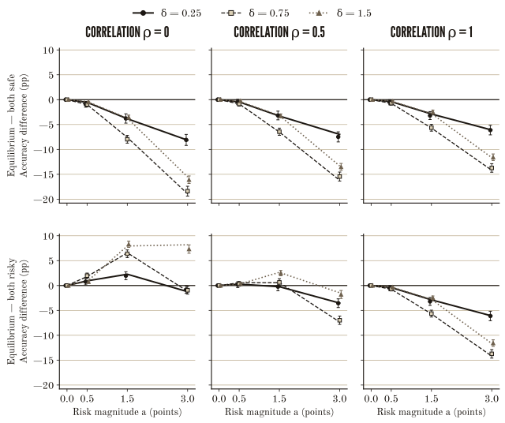

```{python}
#| label: setup
#| include: false
from pathlib import Path
from hashlib import sha256
import json
import sys
sys.path.insert(0, str(Path.cwd() / "src"))
sys.path.insert(0, str(Path.cwd() / "scripts"))
from manufacturing_genius import duel_payoff_matrix, zero_sum_equilibrium
from article_views import comparison_panels, assumption_explorer, fresh_panels, article_contents, signed

study = json.loads(Path("data/generated/study.json").read_text(encoding="utf-8"))
assert study["config_sha256"] == sha256(Path("data/study_config.json").read_bytes()).hexdigest(), "Rerun study after changing config"
assert all(sha256(Path(p).read_bytes()).hexdigest() == digest for p, digest in study['code_sha256'].items()), "Rerun study after changing analysis code"
config, cells = study["config"], study["cells"]
matrix = duel_payoff_matrix(5, 10, 1)
eq = zero_sum_equilibrium(matrix)
independent = zero_sum_equilibrium(duel_payoff_matrix(5, 10, 0))
def cell(delta=.75, risk=1.5, rho=0):
    return next(c for c in cells if c["delta"] == delta and c["risk_size"] == risk and c["correlation"] == rho)
def percent(x):
    return f"{x:.1%}"
def interval(s, scale=1, places=3):
    return signed(f"{s['mean']*scale:.{places}f} [{s['low']*scale:.{places}f}, {s['high']*scale:.{places}f}]")
```

## The last round {#duel}



One thing worth noticing: neither choice changes your score on average. Risky is
+10 or −10 with even odds, so your expected score stays at 105 either way. What
*does* change is your expected share of the prize, and that depends on what your
rival picks too. (I count a tie as half a win throughout, which is why I talk
about prize share instead of win probability. They aren't quite the same
number.)

::: {.static-benchmark}
**The whole game in one table.** Rows are your choices as A, columns are B's,
and each entry is your expected share of the prize, worked out by going through
every possible coin flip.

::: {.compact-table-scroll tabindex="0" role="region" aria-label="Static payoff matrix; scroll if needed"}

```{python}
#| label: exact-table
#| output: asis
print("| A chooses | B safe | B risky |")
print("|---|---:|---:|")
for label, row in zip(("Safe", "Risky"), matrix):
    print(f"| {label} | {row[0]:.0%} | {row[1]:.0%} |")
```

:::

If you both pick the same thing, you keep your lead: either nobody moved, or you
both moved by the same amount. If you pick different things, whoever went risky
can flip the order. So you want to match your rival, and your rival wants to do
whatever you didn't. Neither of you can settle on a predictable move without the
other one taking advantage of it.
:::

The only stable answer is for both of you to randomize. In equilibrium you go
risky `{python} percent(eq.row_risky_probability)` of the time, your rival goes
risky `{python} percent(eq.column_risky_probability)` of the time, and your
expected prize share works out to `{python} percent(eq.value)`. At those odds,
neither of you can do better by switching on your own. This is for one round,
played once, with both choices made at the same time. Any single game still ends
in a win, a loss or a split; the percentages are what you'd get on average.

### Correlation changes the game {#correlation}

Now give each risky player their own coin flip, so the shocks are independent.
The both-risky entry drops to `{python} percent(duel_payoff_matrix(5, 10, 0)[1][1])`,
each player goes risky `{python} percent(independent.row_risky_probability)` of
the time in equilibrium, and your expected share falls to
`{python} percent(independent.value)`. It's the same fair gamble on the menu,
but matching your rival's choice no longer means matching their result.

After the three guided rules, free play lets you move the lead, the correlation
(negative values make the flips tend to go opposite ways) and your rival's rule
wherever you like, including ties and leads sitting right on the edge of what
one flip can undo. Some settings have more than one equilibrium. The game shows
one I've checked, and I'm not claiming it's the only one.

One more thing, and everything after this depends on it: **the two players in
this game are equally good.** Your five-point lead says nothing about skill.
That's the next problem.

## What does a winner tell us? {#opening}

::: {.opening-columns}


That's the question I want to dig into: **can a contest end up rewarding looking
exceptional more reliably than actually being exceptional?** The duel above was
small enough to solve exactly. From here I'll give the players real, lasting
differences in ability and see who the game picks.

One note before the study: every number in here comes from either an exact
calculation or a simulation I ran. None of it is real market or fund data.
:::

<nav class="reading-shortcuts" aria-label="Article shortcuts"><a href="#sign-reversal"><svg aria-hidden="true"><use href="#hand"/></svg>Skip to the main result</a><a href="#results-ledger"><svg aria-hidden="true"><use href="#hand"/></svg>See every result</a></nav>

```{python}
#| label: mobile-contents
#| output: asis
print(article_contents(Path("index.qmd").read_text(encoding="utf-8")))
```

## Now give someone an actual edge {#selection-study}

So far I've only asked who wins. The more interesting question is what winning
*tells you*, and for that the players need to actually differ. In this part,
one player is better than the other by $\delta$ points per round ($+\delta/2$
and $-\delta/2$, assigned at random). That difference sticks around: it shows
up in every round and in any test afterwards.

Each round adds noise on top of ability. A player's first-round score and their
final two-round score are:

$$S_i=\theta_i+\sigma_0Z_i. \qquad
F_i=S_i+\theta_i+a b_iX_i.$$

Here $b_i$ is 0 for safe and 1 for risky, $X_i$ is a fair ±1 coin flip, and $a$
is the size of the gamble. The two players' flips have correlation $\rho$ and
have nothing to do with the first-round noise. Going risky spreads your score
out. It doesn't make you any better, and it doesn't raise your expected score.

I'm being generous to the players here. Each of them knows both abilities and
both first-round scores. The judge (I'll call them the evaluator) never sees
ability and simply picks whoever has the higher final score, with a coin flip
for ties. I don't think real competitors can read each other's talent this
well. It's a simplification that lets me solve every last round exactly.

Because the players know the abilities, what matters going into the last round
is the *effective* gap, $d=S_A-S_B+\theta_A-\theta_B$: the current lead plus the
edge in ability that's about to show up again in round two. The visible lead on
its own isn't enough. From there, each last round is the same kind of game as
the duel above, and I solve each one exactly.

Then I compare strategic risk-taking (the equilibrium) against two simple rules
that just tell players what to do: **both safe**, where nobody's allowed to
gamble, and **both risky**, where everybody has to. Those two are benchmarks,
not something the players would choose themselves. I locked in
`{python} len(cells)` parameter settings, with
`{python} f"{config['replicates']:,}"` independent contests each, before looking
at any results. Noise in the first round and in the later test both have a
standard deviation of `{python} f"{config['sigma_0']:g}"` point.

### Same gamble, opposite answers {#sign-reversal}

This is the part I find most interesting. Hold ability and the size of the
gamble fixed, and only change whether the risky players share one coin flip or
get their own. Compared with forcing everyone to gamble, strategic choice goes
from picking the better player *more* often to picking them *less* often.
Compared with making everyone play safe, it's worse either way.

```{python}
#| label: focused-comparison
#| output: asis
print(comparison_panels(cells))
```

Why does it flip? With independent flips, forcing both players to gamble means a
lead of up to twice the gamble's size can get wiped out (one goes up, the other
goes down). Left to choose, a leader who's ahead by more than one gamble's worth
just plays safe, and the lead can't be caught. Close contests change too, but at
this setting the net effect is that the better player gets picked more often
than under both-risky.

With one shared flip, forcing both players to gamble moves both scores by the
same amount, so the ranking never changes and it's identical to both-safe.
Strategic play is different. In close contests the players randomize, and
sometimes only one of them ends up taking the risk. That can flip the ranking,
and under these assumptions it lowers how often the better player gets picked
overall.

### Try the other settings {#assumptions}

The example above is one of `{python} len(cells)` settings. Pick any of the
others here.

```{python}
#| label: explore-frozen-cells
#| output: asis
print(assumption_explorer(cells, config))
```

### Why both-safe can't be beaten {#safe-benchmark}

I want to be upfront about this: the comparison with both-safe was never going
to come out the other way. Under these assumptions, letting players choose risk
*can't* pick the better player more often than making everyone play safe.
That's a mathematical fact about the setup, and the simulation only measures how
big the gap is.

Here's the intuition. From the better player's side, the effective gap is
$G\sim N(2\delta,2\sigma_0^2)$ (the second number is the variance). It's centred
above zero, so they're more likely to be ahead by any given amount than behind
by it. Risk cuts both ways: sometimes it knocks the better player out of a lead
they deserved, and sometimes it rescues them from a deficit they didn't. Since
the better player is more often the one in front, the knock-outs outnumber the
rescues. It also helps the safe rule that a safe second round is a clean,
noise-free read on ability, and that risk in this model doesn't produce anything
useful.

### The maths {#derivation}

<details id="derivation-panel">
<summary>Exact formulas, for anyone who wants them</summary>

Write $V(g)$ for the equilibrium probability of winning at effective gap $g$.
Label symmetry gives $V(-g)=1-V(g)$, and safe wins exactly when $g>0$ outside
zero-probability ties. If $f$ is the density of $G$, then

$$A_{\mathrm{eq}}-A_{\mathrm{safe}}
=-\int_0^\infty[1-V(g)][f(g)-f(-g)]\,dg\leq0.$$

For $\delta>0$, $f(g)>f(-g)$ at positive $g$, while $V(g)\leq1$.
For $a>0$, away from the boundaries, $V(g)$ equals one for $g>a$,
$v=(2+\rho)/(3+\rho)$ for $0<g<a$, $1-v$ for $-a<g<0$, and zero
for $g<-a$. The leader can guarantee victory by staying safe at $g>a$,
even when both-risky could still overturn the lead.

Let $C$ be the CDF of $G$. Exact accuracy is

$$A_{\mathrm{eq}}=1-C(a)+v[C(a)-C(0)]+(1-v)[C(0)-C(-a)],$$

while $A_{\mathrm{safe}}=1-C(0)$. For both-risky, substitute $2a$ for $a$ and
$(3+\rho)/4$ for $v$. At zero risk every rule agrees. The continuous-noise
formulas ignore only probability-zero boundaries; the discrete tests use the
original tie-aware enumerator. Numerically integrating the enumerated games
checks these formulas independently.
</details>

### Every setting, charted {#selection-grid}

<details id="selection-grid-panel">
<summary>Selection accuracy and paired differences</summary>

::: {.plot-scroll tabindex="0" role="region" aria-label="Selection accuracy figure; scroll horizontally for larger labels"}
{#fig-selection fig-alt="Nine panels: ability gaps in rows, correlations in columns. Accuracy against risk size for equilibrium, both-safe and both-risky. Both-safe is never worse in the exact calculation."}
:::

::: {.plot-scroll tabindex="0" role="region" aria-label="Full paired differences grid"}
{#fig-paired fig-alt="Six panels compare equilibrium minus both-safe and equilibrium minus both-risky across risk magnitude, ability gap and correlation. Null and reversed comparisons are retained."}
:::

</details>

## Meet the winner again {#fresh-evaluation}

Picking a winner is only half of it. The other half is what you see when you
look at them again. So after the contest, I keep everyone's ability the same
and test both players one more time with fresh, independent noise:
$H_i=\theta_i+\sigma_HE_i$. Nobody gets to gamble on this one, and these new
scores never feed back into who won.

Start with the winning score itself. Per round, how far above their real
ability does the winner's score sit? I'll call that gap **overstatement**. It
isn't a measure of anyone lying or cheating. It's what happens when you pick the
higher of two noisy numbers: even if both players were equally good, the winner
would still tend to look better than they are.

Then compare the winner's per-round score from the contest, $F/2$, with how they
do on the fresh test, $H$. Part of the drop is just luck not repeating. Part of
it is that the fresh test runs under different rules (no gamble, new noise).
Calling the whole thing "regression to the mean" skips over that second part.

```{python}
#| label: focused-fresh-evaluation
#| output: asis
print(fresh_panels(cells))
```

```{python}
#| label: overstatement-example
#| output: asis
c = cell()
o = c['policies']['equilibrium']
reported = signed(f"{o['reported_score']['mean']:.3f}")
ability = signed(f"{o['selected_ability']['mean']:.3f}")
print(f"In the independent-flip example, the equilibrium winner scores {reported} points "
      f"per round on average, but their actual ability averages {ability}. That's an overstatement of "
      f"{interval(o['overstatement'])} points. On the fresh test they average "
      f"{interval(o['fresh'])} points, in line with their real ability. "
      f"Brackets are 95% Monte Carlo intervals.")
```

These numbers aren't independent of each other. With unequal abilities,
$E[\theta_{\mathrm{selected}}]=\delta[P(\text{correct})-1/2]$, and in the
simulation that holds exactly for the sample means too. Because the fresh noise
is independent, $E[H_{\mathrm{selected}}]=E[\theta_{\mathrm{selected}}]$. So
selection accuracy, the winner's ability and their fresh performance are really
the same finding measured three ways. What the fresh test does is make the gap
between a great result and a great player easy to see.

When the players are equally able, there's no "better" player, so accuracy
doesn't mean anything. The winner's average ability is zero by construction, but
their score still overstates it. And with no gamble at all, all three rules pick
exactly the same people. I've kept these controls in the full results below.

### Every setting, overstatement and fresh test {#evaluation-grid}

<details id="evaluation-grid-panel">
<summary>Every ability gap and correlation</summary>

::: {.plot-scroll tabindex="0" role="region" aria-label="Full-grid winner overstatement; scroll horizontally for larger labels"}
{#fig-overstatement fig-alt="Twelve panels: four ability gaps, including equal ability, by three correlations. Winner overstatement against risk magnitude under all three rules, with Monte Carlo intervals."}
:::

::: {.plot-scroll tabindex="0" role="region" aria-label="Fresh evaluation figure; scroll horizontally for larger labels"}
{#fig-fresh fig-alt="Three correlation panels compare the three policies. Mean reported winning scores exceed mean selected ability. Mean fresh performance is close to mean selected ability, with Monte Carlo uncertainty."}
:::

</details>

## What I think this actually shows {#interpretation}



## Read the record with the rules attached {#conclusion}



## Methods, sources and reproduction {#methods}

**Published research.** Hvide and Kristiansen look at contests where players
choose how much risk to take (instead of how hard to work) and ask how well those
contests pick out the best player [@hvide2003]. Chen, Hughson and Stoughton study
strategic risk-taking in multi-period mutual fund tournaments; their abstract
describes leaders cutting back on risk depending on how far ahead they are
[@chen2025]. These papers are the background for this piece. My model and my
numbers don't come from either of them.

I also read earlier working versions of both: the
[Norges Bank paper](https://hdl.handle.net/10419/209768) (series 1999/2, text
dated February 2000) and the [SSRN manuscript](https://ssrn.com/abstract=2023805)
(May 2018). I checked their model sections and conclusions and verified the
final journal details and abstracts, but I haven't read the full published
versions. I don't borrow any empirical estimate or proof from either one.

**What's mine.** The playable duel and its exact solutions are toy models I built
for this piece. The ability study is new synthetic analysis under the assumptions
above. It isn't a replication of either paper, none of it is real financial data,
and it can't tell you how hiring panels, funds, managers or markets actually
behave.

**How it's computed.** Seed `{python} config['master_seed']` starts separate
PCG64 random streams for labels, first scores, potential risky shocks, action
draws, tie breaks and the fresh test, with independent streams for each
parameter setting. All three rules share the same underlying draws within each
replicate, so policy differences are paired comparisons. Every original state
maps to one of finitely many exact payoff matrices, and every equilibrium I
report passes a unilateral-deviation check. When a game has more than one pure
saddle point, the solver takes the first in safe/risky row-major order. The
game's value doesn't depend on that choice, but the selected exposures and
overstatement can. No general-sum preferences or alternative rewards are added.

**Uncertainty.** Accuracy uses Wilson intervals. Means and paired differences use
the sample standard deviation over the square root of the replicate count, with
normal intervals. Every interval is a pointwise, approximate 95% Monte Carlo
interval. They measure simulation error inside this model, and say nothing about
whether the model fits any real institution. I've left small fluctuations
between settings and overlapping intervals as they came out.

### Complete results, including nulls and controls {#results-ledger}

<details id="results-ledger-panel">
<summary>Policy estimates and paired comparisons</summary>

Every value here is generated. Accuracy is in percent, everything else in points
per round, and each estimate is followed by its pointwise 95% Monte Carlo
interval. Overstatement is $F_{\mathrm{selected}}/2-\theta_{\mathrm{selected}}$.
"Undefined" marks settings where neither player is more able.

```{python}
#| label: full-ledger
#| output: asis
print('<div class="table-scroll" tabindex="0" role="region" aria-label="Full study results">')
print("\n| δ | a | ρ | Rule | Accuracy % | Selected ability | Overstatement | Fresh performance |")
print("|---:|---:|---:|---|---:|---:|---:|---:|")
for c in cells:
    for p, name in [('equilibrium','Equilibrium'),('safe','Both safe'),('risky','Both risky')]:
        s = c['policies'][p]
        accuracy = interval(s['accuracy'],100,2) if 'accuracy' in s else 'Undefined'
        print(f"| {c['delta']:g} | {c['risk_size']:g} | {c['correlation']:g} | {name} | {accuracy} | "
              f"{interval(s['selected_ability'])} | {interval(s['overstatement'])} | {interval(s['fresh'])} |")
print("\n</div>")
```

The reproduction steps also save paired differences for every defined metric,
per-setting diagnostics and exact accuracies in `data/generated/study.json`.

```{python}
#| label: paired-ledger
#| output: asis
print('<div class="table-scroll" tabindex="0" role="region" aria-label="All paired policy differences">')
print("\n| δ | a | ρ | Equilibrium minus | Accuracy pp | Selected ability | Overstatement | Fresh performance |")
print("|---:|---:|---:|---|---:|---:|---:|---:|")
for c in cells:
    for baseline in ('safe','risky'):
        s=c['paired']['equilibrium-'+baseline]
        accuracy=interval(s['accuracy'],100,2) if 'accuracy' in s else 'Undefined'
        print(f"| {c['delta']:g} | {c['risk_size']:g} | {c['correlation']:g} | Both {baseline} | {accuracy} | "
              f"{interval(s['selected_ability'])} | {interval(s['overstatement'])} | {interval(s['fresh'])} |")
print("\n</div>")
```

</details>

### Settings and how to rerun everything {#reproduction}

<details id="reproduction-panel">
<summary>Study settings and reproduction commands</summary>

::: {.compact-table-scroll tabindex="0" role="region" aria-label="Study settings; scroll if needed"}

```{python}
#| label: design-table
#| output: asis
print("| Setting | Value |\n|---|---|")
for key in ('design_version','replicates','master_seed','sigma_0','sigma_H','delta','risk_size','correlation'):
    print(f"| {key} | `{config[key]}` |")
```

:::

From a clean checkout, create a project environment, install
`requirements-lock.txt`, then install this package with `--no-deps -e .`. Use
that environment's Python for the commands below, and point `QUARTO_PYTHON` at
it before rendering. The README has the full Windows and macOS/Linux steps.

```bash
python scripts/check.py
python scripts/export_reference.py
node scripts/check_browser_math.cjs
python scripts/run_study.py
python scripts/make_figures.py
quarto render index.qmd
```

You end up with a single self-contained `_output/index.html`. It doesn't need a
server or make any data requests. The coin flips in the game use your browser's
randomness for one illustrative play; the exact expectations and study results
don't depend on it.
</details>

## References {.unnumbered}
